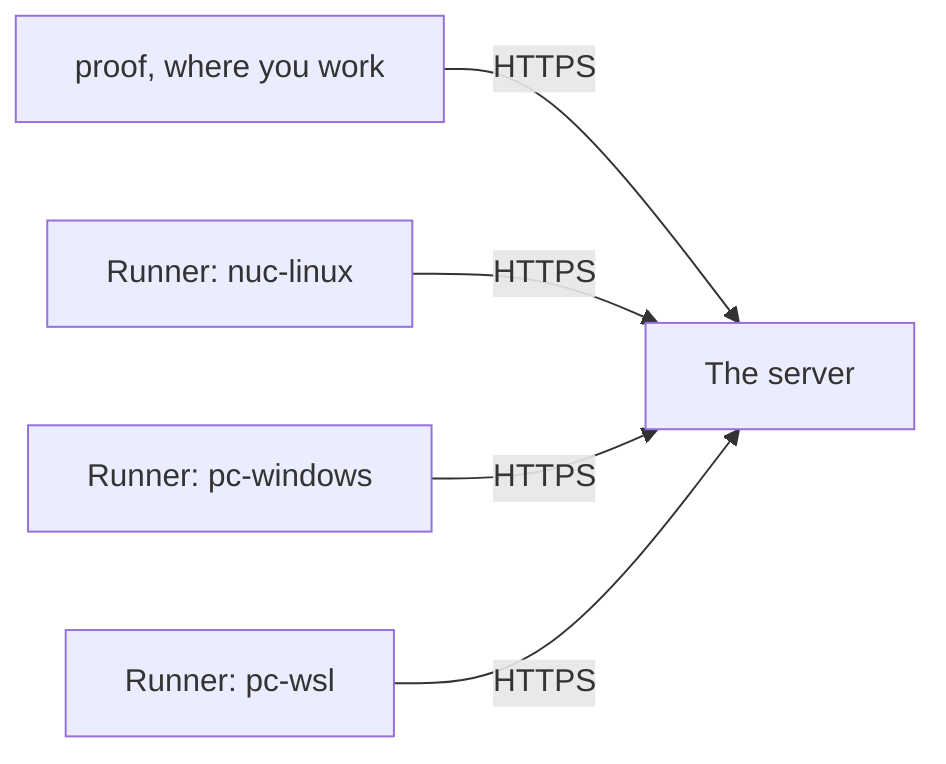

<!--
  SPDX-FileCopyrightText: 2026 setdef <kerrick@setdef.com>
  SPDX-License-Identifier: CC-BY-SA-4.0
-->

# How Proof works

This page explains what happens between typing `proof run test` and seeing its result, and why Proof is built that way. You don't need it to use Proof; read it when you want to know what a run can rely on, or what to expect when something fails. Words in bold are defined in the [glossary](glossary.md).

## One program in three roles

Proof is one program, at one version, in three roles:

- **The `proof` command**, where you or your agents work. It sends code and requests to the server, and prints what comes back.
- **The server**, on one always-on computer. It keeps the **queue**, a Git repository for each project, every run's record, output, and **artifacts**, and the [pool file](reference/pool-file.md). It places each **run** on a **runner**. The server's computer has no runner, so a long build never slows down the computer every other run depends on.
- **A runner** on each operating system that runs your tasks: one on a Linux host, two on a Windows PC with WSL. It runs each run's command and sends its output and status to the server.

Every connection goes from the command or a runner to the server, over HTTPS. Nothing connects to a runner, so a runner can sit behind a home router or on a laptop that changes networks, and its host needs no open port.

The server and every runner run the same version. A runner that finds the server at a newer version downloads that version from the server and restarts with it, between runs. The `proof` command checks the server's version on every call, and when the two differ in a way that matters, it says which one to upgrade.

## How your code reaches a runner

Proof sends code as Git commits, through the server, and never through the project's forge:

1. **`proof` makes a commit of what you're checking.** With `--commit REV`, that is the commit you named. Otherwise, Proof makes a commit of your working tree as it is, with uncommitted changes and with untracked files that Git doesn't ignore. It makes that commit without touching your index, your branch, or `HEAD`, so your clone looks the same afterward.
2. **`proof` pushes the commit to the server's copy of the project,** under a temporary name. Only objects the server doesn't have travel, so a change of one line sends a few kilobytes, not the project.
3. **The runner fetches the commit from the server** into the workspace. It counts the commit as fetched only once it has every object the commit reaches, so a fetch that was cut off can't leave a commit without its files.

Because the code travels as Git, the runner gets the same files you have, with the same file modes, symbolic links, and line endings as Git records them. A run of a commit has its history too, so a task that compares with `HEAD~1` or runs `git log` works. Submodules arrive at the commits the commit records; uncommitted changes inside a submodule are not sent.

The project's forge never sees any of this. A runner needs no credentials for GitHub, and nothing you check is pushed anywhere you didn't push it yourself.

## How the server places a run

A run waits in the queue until the server can place it on a runner, in the order runs arrived. The server places a run on a runner when all of these hold:

- the runner's operating system is one the project file lists for the task, any operating system when it lists none, or the one you named with `--os`;
- the runner has every label the task needs;
- the runner's host has the CPUs and memory the run requests free, counting every runner on that host together.

The server counts resources per **host**, not per runner. A Windows PC with WSL is one host, and the server never gives its two runners more runs together than the PC can run.

The server places each run by these rules alone. It has no priorities, and it never stops one run to make room for another. `proof status` shows what each queued run is waiting behind, so a run that waits a long time says why.

Proof refuses a run that no host could ever run, such as one that requests more memory than any host has, before it sends anything, and says which host comes closest.

## What a runner gives each run

Each runner runs as one ordinary account on its host, set aside for Proof, never as root and never as the account of a person who uses the host. Where a task needs hardware, such as `/dev/kvm` or a GPU's render device, the runner's account gets it through a group, which `proof runner setup` tells an administrator how to add.

For each run, the runner provides:

- **A workspace,** kept from earlier runs of the same project. Before the run, the runner updates the workspace to the commit and removes every file Git doesn't track, ignored files included, so leftover build output can't change the result. What the project's setup installed in the run's home folder, such as the tools mise installs, stays, and so do the project's **caches**. Folders inside the project that Git ignores, such as `node_modules`, go unless the project declares them as caches. `proof run --empty` starts in an empty workspace.
- **Separate folders:** a home folder kept with the workspace, so tools that install into your home install there, and a temporary folder for the run alone, deleted when the run ends. On Linux, the run also gets a separate runtime folder and session bus.
- **A download cache per project,** shared by that project's runs on the host, so a large download arrives once per host.
- **[mise](https://mise.jdx.dev/),** which installs the tools the project's `mise.toml` pins and runs the task. Proof installs nothing of a project's.
- **`CI=true`,** so setup steps that skip work on CI skip it here too.
- **A display, for a task with the `desktop` label.** On Linux, a run gets a separate virtual display. On Windows, each run gets a private desktop, so its windows never take the focus of the person at the PC. On macOS, the run uses the runner's signed-in session.

Runs on one runner share one account, so the folders keep runs apart only as far as the files go. A run's command can still read another project's files in that account.

## How a run ends

A run ends in one of the [run states](glossary.md#run-states). Whatever the reason, the runner ends every process the run's command started, including ones that left the command's process group, before it reports the end. On Linux, the runner uses a systemd user scope for each run where there is one; on Windows, a job object; on macOS, the process group and its descendants.

- **The command exits.** The run has `succeeded` when the status is 0 and the whole output has reached the server, and `failed` otherwise.
- **The time limit passes.** The runner ends the run, and its state is `timed_out`.
- **The host runs short of memory.** Each run is held to its memory request. Where the runner can set a limit, through a systemd scope or a Windows job object, it does. Elsewhere, when the host runs short, the runner ends the run that holds the most memory beyond its request. Either way the state is `out_of_memory`, and the message says how much memory to request next time.
- **Someone cancels it,** with `proof cancel` or Ctrl-C in `proof run`. The state is `canceled`.
- **The runner or its host goes away.** The state is `lost`, and `proof` exits with 75.

Proof never runs a run again by itself. A run that failed, timed out, or was lost stays that way, and you decide whether to run it again.

## How output reaches you

The runner reads the command's standard output and standard error as one stream, in the order the command wrote them, and sends it to the server as it arrives. The server keeps it and sends it to every `proof run` and `proof watch` following the run. Because the runner owns the stream, nothing between the command and the server can drop part of it unseen.

A run counts as `succeeded` only when the server has the whole output, as the runner counted it. A run whose output was cut off short of that is `lost`, even if its command exited with 0, so a pass is never reported for a run whose end nobody saw.

`proof logs` prints the output the server kept, for as long as the [pool file](reference/pool-file.md#retention) says to keep it.

## How Proof gives way to a person

On each host, the runner watches how long it has been since anyone used the keyboard, mouse, or trackpad. While that is shorter than the host's `active-for` setting, a person is **active** there, and Proof keeps the host's **share** of CPUs and memory free for them:

- The server places no new run that would need any of the share.
- Runs already going continue at the lowest priority the operating system has, so they slow down instead of the person's work.
- Runs that need the person's display or GPU wait until the person stops.

When nobody has used the host for longer than `active-for`, runs get the whole host back.

On Windows and Linux, input from runs never counts as a person: runs draw on separate desktops and displays, which the runner leaves out of the measurement.

## Trust and tokens

Each person, agent, or runner that talks to the server holds a **token**. `proof login` gets one for you, and `proof runner approve` gives one to a runner. Proof keeps tokens in files that only their owner can read, never in an environment variable or on a command line.

A token for running work lets its holder run any command, as the runner account, on every runner in the pool: that is what running a task is. Give one only to people and agents you'd give an account on those hosts.

The server's address and certificate fingerprint travel inside the codes `proof server setup` and `proof runner setup` print. So the command and the runners know they're talking to your server from their first connection, with no certificate authority involved.

## Why Proof is built this way

### One server, and runners that connect to it

A pool of a few hosts that people also use has no data center to lean on. One server keeps the queue and the code in one place, and runners that connect to it work from behind any home router. The cost is that the server is one computer: while it's asleep or off the network, no new run starts.

### No existing scheduler

[HTCondor](https://htcondor.org/) gives way to a person at a computer, but by suspending or stopping work rather than running it in what's left. It has no build for Apple silicon, and its Windows install needs an administrator. [Concourse](https://concourse-ci.org/) uploads a local tree and returns the task's status, but its Linux tasks reach a GPU or KVM only when they run as root. GitHub Actions self-hosted runners and Buildkite agents run only code you've pushed, and take their work from a hosted service. Proof's server places runs by operating system, labels, and free resources per host, a few rules that Proof's server applies directly, with no separate scheduler.

### Git as the transport

Git already sends only what changed and checks that nothing is missing, and every runner has it. Sending commits means a run of `HEAD` has the same history as your clone, which tasks that compare commits need.

### Reused workspaces

Most runs are several times faster in a reused workspace, because the tools, dependencies, and caches are already there. Reuse can hide a fault, such as a setup step that never installs what an earlier run left behind, and it can cause one, such as a file left from another commit. Proof removes every file Git doesn't track before each run, which prevents most faults of the second kind, and `--empty` shows whether a project builds from nothing.

### No root, ever

A runner shares its host with someone. Running as an ordinary account, with hardware granted through groups, means a run can't change the system it runs on, and setup never needs more than the few administrator commands it prints for you to run yourself.
