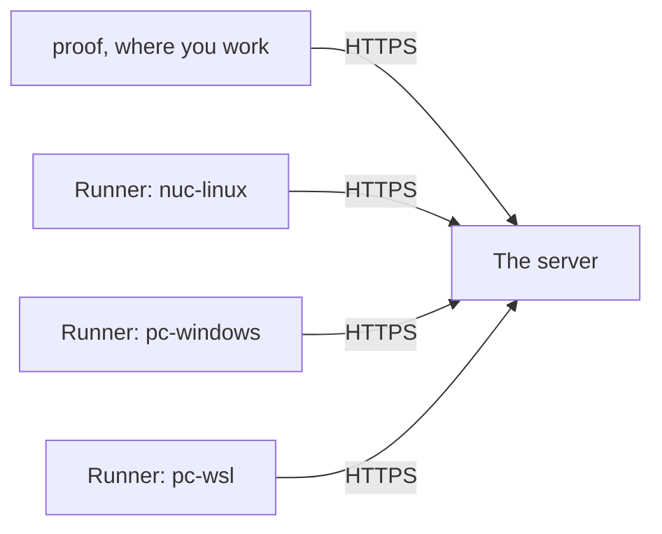

# How Proof works

This page explains what happens between typing `proof run test` and seeing its result, and why Proof is built that way. You don't need it to use Proof; read it when you want to know what a run can rely on, or what to expect when something fails. Words in bold are defined in the [glossary](glossary.md).

## One program in three roles

Proof is one program, at one version, in three roles:

- **The `proof` command**, where you or your agents work. It sends code and requests to the server, and prints what comes back.
- **The server**, on one always-on computer. It keeps the **queue**, a Git repository for each project, every run's record, output, and **artifacts**, and the [pool file](reference/pool-file.md). It places each **run** on a **runner**. The server's computer has no runner, so a long build never slows down the computer every other run depends on.
- **A runner** on each operating system that runs your tasks: one on a Linux host, two on a Windows PC with WSL. It runs each run's command and sends its output and status to the server.

Every connection goes from the command or a runner to the server, over HTTPS. Nothing connects to a runner, so a runner can sit behind a home router or on a laptop that changes networks, and its host needs no open port.

The server and every runner run the same version. A runner that finds the server at a newer version downloads that version from the server and restarts with it, between runs. The `proof` command checks the server's version on every call, before it sends anything, and when the two differ in a way that matters, it says which one to upgrade. The request it makes for the server's version is the same in every version, so a command of any version can learn the version of a server of any other. Nothing about a version is fixed in Proof's code, so a new pool works from its first install.

## How your code reaches a runner

Proof sends code as Git commits, through the server, and never through the project's forge:

1. **`proof` makes a commit of what you're checking.** With `--commit REV`, that is the commit you named. Otherwise, Proof makes a commit of your working tree as it is, with uncommitted changes and with untracked files that Git doesn't ignore. It makes that commit without touching your index, your branch, or `HEAD`, so your clone looks the same afterward.
2. **`proof` pushes the commit to the server's copy of the project,** under a temporary name. Only objects the server doesn't have travel, so a change of one line sends a few kilobytes, not the project. Every clone of one repository shares that copy, because Proof identifies a project by its repository's root commit.
3. **The runner fetches the commit from the server** into the workspace. It counts the commit as fetched only once it has every object the commit reaches, so a fetch that was cut off can't leave a commit without its files.

Because the code travels as Git, the runner gets the same files you have, with the same file modes, symbolic links, and line endings as Git records them. A run of a commit has its history too, so a task that compares with `HEAD~1` or runs `git log` works. Submodules arrive at the commits the commit records. For a run of your working tree, that is the commit each submodule's checkout is at, so a submodule bump you haven't committed is tested too. Uncommitted changes inside a submodule are not sent.

The project's forge never sees any of this. A runner needs no credentials for GitHub, and nothing you check is pushed anywhere you didn't push it yourself.

### Which project, and which files

The project is the Git repository that contains the folder you run `proof` in, or the folder you give `-C`. Outside any repository, `proof` refuses rather than guess. Its first line shows the project's root folder and the commit it sends, so an agent whose shell drifted into another project's folder sees it at once.

A run of your working tree follows these rules:

- **A file Git tracks goes even when `.gitignore` matches it,** and so does a file you staged with `git add -f`, because both are in the project as Git records it.
- **A project with no commit yet can still run its working tree,** so a new repository isn't refused. `--commit` of any revision there is refused, because the project has no commit for a revision to name.
- **Nothing else in your clone changes.** Apart from new objects, every file under the clone's `.git` stays as it was, and nothing is left running afterward, whatever the clone's settings, in a linked worktree, and while another Git process holds the clone's index.
- **It works the same from a Git hook,** including in a linked worktree, where the variables Git gives a hook would otherwise point every Git command elsewhere.
- **A partial clone can't be sent,** because it lacks some of the objects a commit reaches. Proof refuses it and says so.

### Slow links

A transfer fails only when it stalls, when too little arrives for too long, never because the whole of it takes a while. So a slow link still works, and Proof finds a dead one without waiting for a deadline on the whole transfer, which would make every retry start from nothing. A transfer counts as complete only when every byte has arrived, because a dropped connection can look like the end of the input. When a try fails, the message says how it ended: it stalled, it was cut off, or nothing answered.

## How the server places a run

A run waits in the queue until the server can place it on a runner. Among the runs that can be placed now, the one that arrived first goes first, and a run that fits nowhere at the moment doesn't hold up the runs behind it. The server places a run on a runner when all of these hold:

- the runner's operating system is one the project file lists for the task, any operating system when it lists none, or the one you named with `--os`;
- the runner has every label the task needs;
- the runner's host has the CPUs and memory the run requests free, counting every runner on that host together, and leaving the host's memory share free, and its CPU share free while a person is active;
- the run fits the runner's capacity, which can be less than its host's: a runner in a virtual machine, such as WSL, can have less memory than the PC.

The server counts resources per **host**, not per runner. A Windows PC with WSL is one host, and the server never gives its two runners more runs together than the PC can run.

The server places each run by these rules alone. It has no priorities, and it never stops one run to make room for another. `proof status` shows what each queued run is waiting behind: the runs that hold the host it needs, a person active there, a host that needs someone to sign in, or no connected runner of its operating system. A run that waits a long time without saying why looks hung. A run whose operating system has no runner connected stays queued, because hosts come back. The cost of placing the earliest run that fits is that a run that requests a lot, such as 16 GB, can wait indefinitely while runs that request 2 GB keep taking the memory it needs, because the server shares nothing fairly between runs.

From its placement until it ends, a run is `running`, even before its command starts. `proof status` shows what it is doing then: fetching its code, waiting for a desktop or for a person to leave, running its command, or sending its output.

Proof refuses a run that no host could ever run, such as one that requests more memory than any host has, before it sends anything. The message says which host fits the most of the request, which is the host whose worst shortfall is the smallest, so a host with plenty of CPUs and too little memory doesn't beat one that is close on both. It lists every resource that host lacks, with what the host could ever have free and what the run requested, so the message says what to change.

## What a runner gives each run

Each runner runs as one ordinary account on its host, set aside for Proof, never as root and never as the account of a person who uses the host. Where a task needs hardware, such as `/dev/kvm` or a GPU's render device, the runner's account gets it through a group, which `proof runner setup` tells an administrator how to add.

For each run, the runner provides:

- **A workspace,** kept from earlier runs of the same project, and used by one run at a time. Before the run, the runner updates the workspace to the commit and removes every file Git doesn't track, ignored files included, so leftover build output can't change the result. What the project's setup installed in the run's home folder, such as the tools mise installs, stays, and so do the project's **caches**. Folders inside the project that Git ignores, such as `node_modules`, go unless the project declares them as caches. A workspace left by a run that was killed outright is deleted and started empty, with a line saying so, because its half-written files and stale Git locks would fail every later run there. `proof run --empty` empties the workspace used least recently, rather than making a new one, so repeated empty runs don't make more and more workspaces.
- **Separate folders:** a home folder kept with the workspace, so tools that install into your home install there, and a temporary folder for the run alone, deleted when the run ends, and removed before the next run when a run that was killed outright left it behind. On Linux, the run also gets a separate runtime folder and session bus.
- **A download cache per project,** shared by that project's runs on the host, so a large download arrives once per host. Runs that write to it at once never leave it half-written.
- **[mise](https://mise.jdx.dev/),** which installs the tools the project's `mise.toml` pins and runs the task. Proof installs nothing of a project's. Every runner has the latest release of mise, and updates it when Proof upgrades, so one commit behaves the same on hosts set up months apart.
- **A separate environment:** `CI=true`, unless the task sets `CI` itself, so setup steps that skip work on CI skip it here too; Proof's variables, named `PROOF_*`; and no `SSH_AUTH_SOCK`, so a run can't use the account's SSH agent or keyring.
- **A lower priority than the host's services.** Runs start at a lower scheduling priority, and on Linux with a higher out-of-memory score, so the host's system services outlive them.
- **Sound, for a task with the `sound` label.** On Linux, a run gets a separate virtual audio device. On Windows and macOS, the run plays through the host's speakers, and waits while a person is active there.
- **A display, for a task with the `desktop` label.** On Linux, a run gets a separate virtual display. On Windows, each run gets a private desktop, so its windows never take the focus of the person at the PC. On macOS, the run uses a signed-in session of the runner's account, and waits while there is none.

Runs on one runner share one account, so the folders keep runs apart only as far as the files go. A run's command can still read another project's files in that account.

## How a run ends

A run ends in one of the [run states](glossary.md#run-states). Whatever the reason, the runner ends every process the run's command started, including its grandchildren, ones that left the command's process group, and daemons that forked themselves away, before it reports the end. On Linux, the runner uses a systemd user scope for each run where there is one; on Windows, a job object; on macOS, the process group and its descendants. To end a run, the runner sends `TERM`, and `CONT` to a stopped process, then `KILL` after a grace period, and reports the processes it had to kill.

- **The command exits.** The run has `succeeded` when the status is 0, the whole output has reached the server, and Proof kept the run's artifacts. It has `failed` otherwise: a command that exits with 0 but whose artifacts Proof couldn't keep leaves a `failed` run, and `proof` exits with 78.
- **The server is short of space for the run's artifacts.** A run's artifacts aren't known until it ends, so when a run starts, the server checks that its free space is at least the pool's `limits artifacts` for one run. When it isn't, the run ends `failed` before its command starts, and `proof` exits with 78 and a message saying the server is short of space. A run is never kept queued for space, because nothing on the server frees space by itself. This keeps a run from doing all its work only to fail at the end, except when two runs fill the disk together: the server reserves no space, so the second of two runs that each fit fails when its artifacts arrive.
- **The time limit passes.** The runner ends the run, and its state is `timed_out`.
- **The host runs short of memory.** Each run is held to its memory request. Where the runner can set a limit, through a systemd scope or a Windows job object, it does. Elsewhere, when the host runs short, the runner ends the run that holds the most memory beyond its request. Either way the state is `out_of_memory`, and the message says how much memory to request next time.
- **Someone cancels it,** with `proof cancel` or Ctrl-C in `proof run`. The state is `canceled`. A run still in the queue can be canceled too, and it ends `canceled` without a runner. When someone else cancels a run, or the pool does, as when you revoke its runner, the `proof run` or `proof watch` following it exits with 130, and the result line says who canceled it. Status 75 stays for a failure of the pool that running again may fix.
- **The runner stays out of contact with the server for 10 minutes,** as when its host goes away or loses its network. The state is `lost`, and `proof` exits with 75. A runner that reconnects sooner sends the output it kept, and the run ends as it would have. A report that arrives after the 10 minutes is refused, even a complete one, because `lost` is final. The host's CPUs and memory stay held until the runner reports that the run's processes ended, or you revoke the runner, so a host never runs more than it has.

Ten minutes covers a laptop that changes networks or wakes from sleep, and an agent waiting on a dead host learns of it within 10 minutes. The 10 minutes count only while the server is up. A server that restarts or upgrades counts a runner as away only from the moment the server is back, so a server outage never makes a run `lost`. Counting through the outage would lose every run to any upgrade that took longer than 10 minutes.

A run's exit status always comes from its command, never from anything between the command and the runner, because a wrapper that exits 0 when the command was killed would report a pass that didn't happen.

A run's time limit starts when its command starts. Time spent queued, setting up the workspace, or waiting for a desktop or for a person to leave doesn't count against it, and `proof` shows that waiting as it happens.

Proof never runs a run again by itself. A run that failed, timed out, or was lost stays that way, and you decide whether to run it again. The one retry comes before the command starts: when Git operations on a runner's workspace fail, the runner discards that workspace and tries the run once in another, and no command has run yet.

## How output reaches you

The runner reads the command's standard output and standard error as one stream, in the order the command wrote them, because people and agents read a run top to bottom, and sends it to the server as it arrives. The runner keeps a copy, so output survives a lost connection to the server, and sends the copy when the connection comes back. The server keeps the output and sends it to every `proof run` and `proof watch` following the run, and a slow follower never holds up the run or the other followers. Because the runner owns the stream, nothing between the command and the server can drop part of it unseen.

A follow picks up from a place in the output, so `proof watch` after a dropped connection goes on where it left off, with nothing dropped and nothing repeated.

A run counts as `succeeded` only when the server has the whole output, as the runner counted it. A run whose output was cut off short of that is `lost`, even if its command exited with 0, so a pass is never reported for a run whose end nobody saw.

`proof logs` prints the output the server kept, for as long as the [pool file](reference/pool-file.md#retention) says to keep it.

## What the server keeps of a run

The server keeps a **record** of each run: its ID, task, commit, runner, state, exit status, resource use, and times. The times are on the server's clock, because the clocks of hosts, and of the computer where you run `proof`, can differ. A record never holds the command's arguments or environment, which can carry secrets. Two writes to a record at once never interleave or lose part of it.

The server keeps each of a run's **artifacts** only when its SHA-256 and size match what arrived, and once all have arrived, it seals them with the run's **manifest**, after which nothing is added. It refuses a path that is absolute or contains `..`, and two names that differ only in case, which would be one file on Windows and macOS.

Wherever Proof asks for a run's ID, its last five characters work, matched against the last 7 days of runs. When five characters match more than one, the server refuses them and lists the matches.

The server keeps one copy of each project's repository. It repacks each one, and deletes the temporary names of runs past their [retention](reference/pool-file.md#retention).

## When an agent runs `proof`

Most runs come from coding agents, inside agent harnesses, and `proof` is built for how harnesses behave:

- **Nothing for a shell to parse.** Every task and script runs as `proof run NAME` or `proof run --script FILE`, because harnesses refuse compound commands such as `bash -c '...'` from their sub-agents.
- **`TERM` cancels the run.** A harness that stops an agent sends `TERM`, often twice, to the whole process tree. `proof run` cancels its run on the first, and exits once the server has heard, or after a bounded wait. `proof watch` stops watching and leaves the run going.
- **A closed pipe cancels the run too.** When standard output is closed, as by a pipe into `head`, `proof` cancels the run and exits with 141, rather than let it go on unseen.
- **The result is never lost.** The run's ID is in the first lines, and `proof watch ID` exits with the run's status, so an agent that started `proof` in the background, or whose harness ended, can still learn how the run ended.
- **`proof` never sits silent.** It prints a line before it connects to anything.
- **A mistake says what to do next.** Each message says what went wrong in plain words and ends with the command to run next. Proof keeps a debug log under `~/.local/state/proof/`, never in the current folder.

## How Proof gives way to a person

A **person** comes first, whoever they are: anyone at the host's keyboard, mouse, trackpad, or screen, not only one owner. On each host, the runner watches how long it has been since anyone used the keyboard, mouse, or trackpad. While that is shorter than the host's `active-for` setting, a person is **active** there. When the runner can't tell whether anyone is there, it counts them as present. Proof keeps the host's **share** of CPUs and memory free for a person in two ways:

- **The memory share is free always,** whether or not anyone is at the host, because memory a run holds can't be taken back when a person arrives. The server places no run that would need any of it. An idle host leaves that memory unused.
- **The CPU share is free while a person is active.** The server places no new run that would need any of it, and runs already going continue at the lowest priority the operating system has, so they slow down instead of the person's work. Priority takes CPU back, so when no one is active, runs can use the share's CPUs.

While a person is active, runs that need their display, GPU, or speakers wait until they stop.

When nobody has used the host for longer than `active-for`, runs get the share's CPUs back.

On Windows, a run that needs the display is placed only while no person is active, and one already using the display when a person arrives isn't stopped. The person finds the display busy until the run ends, which its time limit bounds.

On Windows and Linux, input from runs never counts as a person: runs draw on separate desktops and displays, which the runner leaves out of the measurement.

## Trust and tokens

Each person, agent, or runner that talks to the server holds a **token**. `proof login` gets one for you, and `proof runner approve` gives one to a runner. Proof keeps tokens in files that only their owner can read, never in an environment variable or on a command line.

There are three kinds of token, and Proof records the kind when it issues one. A person's token can approve and revoke runners and cancel any run. An agent's can run, watch, download, and cancel its own runs. A runner's can do only a runner's work, because a runner never needs a person's powers.

A token for running work lets its holder run any command, as the runner account, on every runner in the pool: that is what running a task is. Give one only to people and agents you'd give an account on those hosts.

The server makes its key and certificate once, and never replaces them, because the command on every computer that trusts the server, and every runner, keeps its key's **fingerprint**, and refuses a server with any other key.

The codes `proof server setup` and `proof runner setup` print also prove the server. Before `proof login` sends a code, the server shows it knows that code. A runner trusts the server only after you approve it from a computer that already does. So the command and the runners know they're talking to your server from their first connection, with no certificate authority involved.

## Why Proof is built this way

### Three values in balance

Proof does three things for a developer whose coding agents check every change. It gets the work off the computer they work at, so test suites stop hammering its CPU and memory and stop flashing windows across their screen. It runs the work where they can't: a compiler that builds only for the operating system it runs on, or a bug that shows only on Windows. And it is CI for trunk-based development, before the push as well as after: an agent learns whether a change works, from the working tree or any commit, in a private or unpushed repository, without paying for minutes and without pushing to a forge and polling it while a lone Mac runner works through its queue.

Each is easy alone, and each pulls against the others. Getting work off your computer puts it on another, where a person may be working or gaming. Running where you can't means waiting for the one Mac you have. Checking every change fills the queue the other two wait in. So a run must leave every host usable by the person at it, reach the hardware it needs, and still answer sooner than pushing and polling would. A design that serves one of the three by spending another isn't done: freeing your screen by flashing windows on someone else's, reaching the Mac by making every run wait for it, or answering sooner with a pass nobody saw. The answer is worth having only when it's true, so Proof never reports a pass that didn't happen.

### One server, and runners that connect to it

A pool of a few hosts that people also use has no data center to lean on. One server keeps the queue and the code in one place, and runners that connect to it work from behind any home router. The cost is that the server is one computer: while it's asleep or off the network, no new run starts.

### No existing scheduler

[HTCondor](https://htcondor.org/) gives way to a person at a computer, but by suspending or stopping work rather than running it in what's left. It has no build for Apple silicon, and its Windows install needs an administrator. [Concourse](https://concourse-ci.org/) uploads a local tree and returns the task's status, but its Linux tasks reach a GPU or KVM only when they run as root. GitHub Actions self-hosted runners and Buildkite agents run only code you've pushed, and take their work from a hosted service. Proof's server places runs by operating system, labels, and free resources per host, a few rules that Proof's server applies directly, with no separate scheduler.

### Git as the transport

Git already sends only what changed and checks that nothing is missing, and every runner has it. Sending commits means a run of `HEAD` has the same history as your clone, which tasks that compare commits need.

### Reused workspaces

Most runs are several times faster in a reused workspace, because the tools, dependencies, and caches are already there. Reuse can hide a fault, such as a setup step that never installs what an earlier run left behind, and it can cause one, such as a file left from another commit. Proof removes every file Git doesn't track before each run, which prevents most faults of the second kind, and `--empty` shows whether a project builds from nothing.

### No root, ever

A runner shares its host with someone. Running as an ordinary account, with hardware granted through groups, means a run can't change the system it runs on, and setup never needs more than the few administrator commands it prints for you to run yourself.
